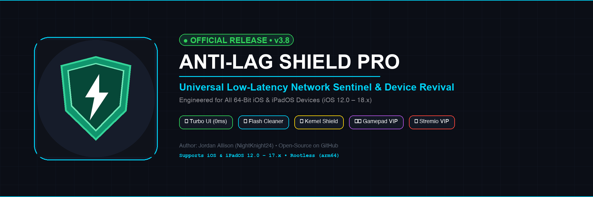

# Anti-Lag Shield

**Network Latency & TCP Dynamic Buffer Optimizer for iPadOS & iOS**

[](https://github.com/NightKnight24/AntiLagShield)
[](https://github.com/NightKnight24/AntiLagShield)
[](license.html)
[](https://www.youtube.com/@NightKnight24)

Anti-Lag Shield is a lightweight, passive network tuning suite and latency optimizer for 64-bit iPadOS and iOS devices. Built specifically to eliminate micro-stutters and bufferbloat in high-throughput video streaming (Stremio, YouTube, Netflix, Disney+) and cloud gaming (Moonlight, GeForce NOW, RetroArch, Roblox).

---

## 🎥 YouTube Showcase & Demo

Watch the official 1080p feature walkthrough and demonstration on YouTube:

[](https://www.youtube.com/@NightKnight24)

> 📺 **[Click here to watch the full Video Showcase on YouTube](https://www.youtube.com/@NightKnight24)**  
> *(Leave feedback, questions, or device benchmark results in the video comments!)*

---

## ⚡ Key Features & Architecture

### 1. 🎛️ Three Quick-Toggle Options
Switch modes instantly from anywhere on your device:
* **Control Center Module (`CCSupport`):** Swipe down from the top-right corner inside any app or game, and tap the Anti-Lag Shield module to toggle between Active and Off.
* **Interactive Notification Banner:** Pull down or hold the banner in the Notification Center / Lock Screen to switch between `🎬 Streaming`, `🎮 Gaming`, and `🛑 Turn Off`.
* **Siri Shortcuts & Widgets:** Custom URL schemes (`shield://streaming`, `shield://gaming`, `shield://off`) allow 1-tap switching from Lock Screen circular widgets, Home Screen icons, or voice commands.

### 2. 🚀 100% Passive Kernel Model (0% Background CPU)
* **Zero Background Loops:** No persistent daemon loops, no process forks, and 0% idle CPU drain.
* **XNU Kernel Resident:** Network optimizations are applied directly to the Darwin kernel (`sysctl`) and remain locked in kernel memory.
* **Adaptive Delayed ACK:**
  * **Streaming Mode (`net.inet.tcp.delayed_ack=3`):** Adaptive RFC 5681 delayed ACK rate delivers high-throughput TCP window scaling without flooding the router with ACK packets.
  * **Gaming Mode (`net.inet.tcp.delayed_ack=0`):** 0ms instant acknowledgment for real-time competitive gaming packet response.
* **4MB Dynamic Socket Buffers:**
  * `net.inet.tcp.autorcvbufmax=4194304` (4 MB)
  * `net.inet.tcp.recvspace=2097152` (2 MB)
  * Eliminates memory pressure while ensuring smooth 1080p60 / 4K streaming buffers.
* **TSO Offload:** Hardware TCP Segmentation Offload enabled (`net.inet.tcp.tso=1`) to offload packet processing directly to the network interface controller.

### 3. 🔒 Static Hardware ARP Gateway Lock
* Auto-discovers your local Wi-Fi router's default gateway IP and queries its hardware MAC address.
* Permanently locks the gateway into the Darwin kernel ARP table (`arp -s <ip> <mac> permanent`), completely eliminating ARP discovery latency and protecting against LAN packet poisoning.

### 4. 🧹 Inactive RAM & Flash Storage Cleaners
* **Mach Kernel Memory Purge:** Flushes stale inactive memory pages via native Mach kernel calls and measures exact megabytes reclaimed before and after.
* **Safe Storage Purge:** Reclaims flash storage by clearing expired WebKit caches, crash reporter logs, and stale diagnostic dumps without touching user data.

### 5. 🎯 Priority Process Scheduling
* Elevates critical media and gaming streaming engines (`mediaserverd`, `Stremio`, `NodeMobile`, `YouTube`, gamepads) to high CPU scheduling priority (`nice -10`), preventing background tasks from starving real-time audio/video decoding threads.

---

## 📦 Installation

### Option 1: Add to Sileo or Zebra (APT Repository)
Add the official personal repository to your package manager:
```text
https://nightknight24.github.io/repo/
```
* **[⚡ Add to Sileo](sileo://source/https://nightknight24.github.io/repo/)**
* **[🦓 Add to Zebra](zbra://sources/add/https://nightknight24.github.io/repo/)**

### Option 2: Direct Debian Package (.deb)
Download the clean Debian package directly from releases:
* **[`com.nightknight.antilagshield_1.0.0_iphoneos-arm64.deb`](https://github.com/NightKnight24/AntiLagShield/releases/latest)**

Install via Filza or terminal:
```bash
dpkg -i com.nightknight.antilagshield_1.0.0_iphoneos-arm64.deb
```

---

## 📱 Device Compatibility

Compiled with universal 64-bit arm64 architecture (`minos 12.0`):

| Device Family | Models Supported | iOS / iPadOS Range |
| :--- | :--- | :--- |
| **iPads (A9 - A10X)** | iPad 5th/6th/7th Gen, iPad Air 2, iPad mini 4, iPad Pro 1st/2nd Gen | iPadOS 12.0 – 17.7.x |
| **Modern iPads (M1 - M4)** | iPad mini 5/6, iPad Air 3–5 (M2), iPad Pro (M1, M2, M4) | iPadOS 13.0 – 18.x |
| **iPhones (A9 - A17)** | iPhone 6s through iPhone 16 Pro Max | iOS 12.0 – 18.x |

---

## 🛠️ CLI Quick Reference

The suite includes the standalone `/var/jb/usr/bin/shield_ctl` controller:

```bash
# Check current active mode
shield_ctl status

# Start Streaming Mode (Adaptive ACK rate 3, 4MB buffer)
shield_ctl start streaming

# Start Gaming Mode (0ms instant ACK, low latency)
shield_ctl start gaming

# Stop shield and restore stock iOS settings
shield_ctl stop

# Clean inactive RAM memory pages
shield_ctl purge

# Safe flash cache clean
shield_ctl clean

# View or auto-detect gateway configuration
shield_ctl config show
shield_ctl config auto
```

---

## 📄 License & Credits

* **Author:** Jordan Allison ([@NightKnight24](https://github.com/NightKnight24))
* **License:** [MIT License](license.html)
* **Feedback & Discussions:** Check the [YouTube Video Comments](https://www.youtube.com/@NightKnight24) or open an issue on GitHub!
